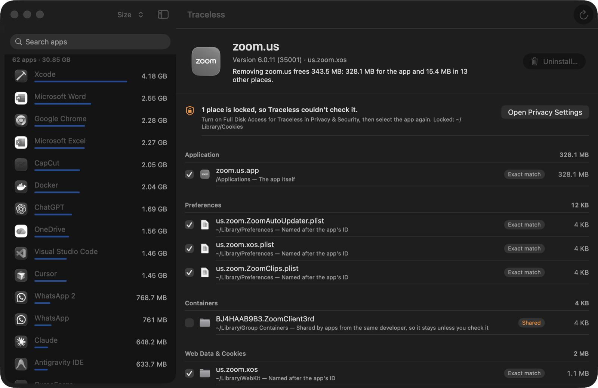

# Traceless

A free, open-source macOS 26 (Tahoe) uninstaller that removes an app and every trace it leaves,
shows what each app really takes on your disk, and lets you undo any uninstall.
Native SwiftUI, no subscriptions, no tracking, no network access.

**Español:** Traceless desinstala apps en Mac de verdad: encuentra cachés, preferencias,
contenedores y procesos en segundo plano, lo manda todo a la Papelera y te deja deshacerlo. Gratis.

## Install
1. Download `Traceless.zip` from [Releases](../../releases/latest), unzip, and move Traceless to Applications.
2. The build is not notarized yet, so the first time: right-click Traceless › Open › Open
   (or System Settings › Privacy & Security › Open Anyway).
3. Or build it yourself: `git clone`, then `./build.sh` (needs Xcode 26).

Tested on macOS 26.7.1 (Apple silicon). Needs macOS 26.

## Use
- Open Traceless. A spinning wheel measures every app
  in /Applications and ~/Applications, using the real space on disk (allocated blocks, hard links once).
- Pick an app: Traceless lists each leftover with where it is, why it matched, and its size.
- **Uninstall…** (⌘⌫) quits the app and moves everything to the Trash. **Restore** or
  **App › Restore Last Uninstall** puts it all back.
- For complete scans, turn on Full Disk Access for Traceless (the app tells you which places were locked).

Terminal: `Traceless.app/Contents/MacOS/Traceless --cli list | scan <name> | uninstall <name> --yes | restore <record.json>`

Logs: `~/Library/Logs/Traceless/Traceless.log` and unified log subsystem `com.isaacmendez.Traceless`.
Undo records: `~/Library/Application Support/Traceless/History/`.

## Complaints about other uninstallers, and what Traceless does instead
| Complaint (source) | Traceless |
| --- | --- |
| Deleted system files / personal files (CleanMyMac threads on MacRumors, Apple Community) | Hard safety rules: only inside Library areas, /Applications bundles and the user's /var/folders; never Documents, iCloud, Mail, Messages, Keychains, /System |
| Partial-name false positives, e.g. "Opera" → operations.pdf; OpenSCAD uninstall deleted ~/Documents/OpenSCAD (Pearcleaner issues) | Whole-name or bundle-ID matches only; never searches user documents |
| Removes files shared with other apps | Group containers from the same developer and same-named items are flagged "Shared" and left unchecked |
| Misses daemons, helpers, installer leftovers (AppCleaner reviews) | Reads launch-agent/daemon plists for programs inside the app, embedded helper IDs, privileged helpers, pkg receipts (`pkgutil --forget`), crash reports, /var/folders caches, Dock icon, Launch Services |
| Silent misses because of macOS privacy locks | Lists every place it couldn't read and links to Full Disk Access |
| Permanent deletion, no undo | Everything goes to the Trash; a JSON undo record restores it |
| Subscriptions and upsells (Nektony, MacPaw) | Free, no account |
| App keeps running / web apps ignored | Quits the app, including Safari web apps hosted by Apple's "Web App" process |

## Build
`./build.sh` (Xcode 26 toolchain, Swift 6.4 compiler in Swift 5 mode, ad-hoc signed).

## Experiments
See [Experiments/README.md](Experiments/README.md): the first real run (the Spotify web app plus
537 MB left by an old desktop Spotify), the bugs it exposed, and the run after the fixes.

## Contributing
Issues and pull requests are welcome, especially reports of an app whose leftovers Traceless
missed or over-matched. Include the lines from `~/Library/Logs/Traceless/Traceless.log`.

## Credits
Made by Isaac Méndez Rosario at [Magna Web](https://magnaweb.net) · Instagram [@magna.web](https://www.instagram.com/magna.web/).
MIT License.
